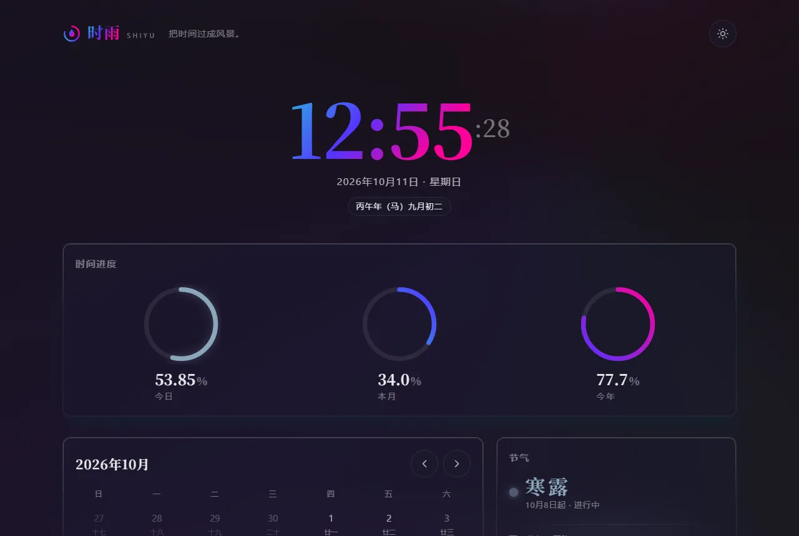
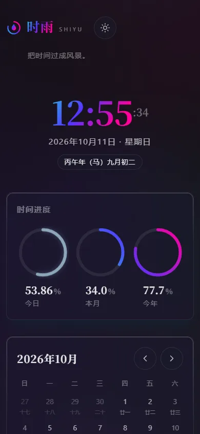

# 时雨 · Shiyu

> 把时间过成风景。

一个纯前端的日历与时间小站：倒计时与纪念日、今日 / 本月 / 今年进度圆环、
农历与节日、二十四节气、番茄钟。数据只存在你自己的浏览器里（localStorage），
没有后端、没有账号、运行时零网络请求。


## 界面

| 桌面（暗色极光） | 移动端 |
| --- | --- |
|  |  |

## 功能

| 模块 | 说明 |
| --- | --- |
| 倒计时 / 纪念日 | 添加「名称 + 日期」，卡片显示「还有 N 天 / 已过去 N 天 / 就是今天」，可删除，localStorage 持久化 |
| 时间进度 | 今日 / 本月 / 今年三个 SVG 圆环，按毫秒实时平滑走动，等宽衬线数字 |
| 农历与节日 | `Intl.DateTimeFormat('zh-CN-u-ca-chinese')` 系解析农历（含闰月、干支、生肖）；农历节日：春节、元宵、端午、中秋、重阳、腊八、除夕；公历节日内置表（元旦、劳动节、国庆等） |
| 二十四节气 | 寿星通用公式（C 值法 + 世纪常数 + 闰年修正 + 例外校准），显示当前节气段、下一节气与剩余天数；全站强调色跟随今日节气（取意中国传统色） |
| 月历 | 公农历对照、节气与节日标注、今日节气色圆环，可翻月 |
| 番茄钟 | 25 / 5 分钟，圆环进度动画，结束时用 Web Audio 现场合成一声柔和钟鸣（无音频文件） |
| 双主题 | 暗色极光（默认）/ 浅色纸感，一键切换并记忆 |

视觉：极光背景（radial + conic 渐变、blur、60s+ 漂移）、玻璃卡片
（backdrop-filter + 1px 渐变描边）、节气光晕卡、衬线大字 +
`tabular-nums` 等宽数字。设计规格与实现拆解见 [docs/design.md](docs/design.md)。

## English Quick Start

Requirements: Node.js ≥ 20.19, pnpm 11.

```bash
# 1. Install dependencies
pnpm install

# 2. Regenerate WebP assets (optional; public/ already ships with them)
pnpm assets

# 3. Run unit tests (vitest)
pnpm test

# 4. Production build (includes vue-tsc type check)
pnpm build

# 5. Preview the build
pnpm preview
```

No backend, no router, no runtime network requests — everything runs in the
browser and persists to `localStorage`.

## 构建体积（实测）

`pnpm build`（vue-tsc 严格类型检查 + vite build，gzip -9 实测）：

| 产物 | 原始 | gzip |
| --- | --- | --- |
| `assets/index-*.js` | 90,239 B | **35,408 B（34.6 KB）** |
| `assets/index-*.css` | 18,939 B | **4,687 B（4.6 KB）** |
| `index.html` | 1,099 B | 556 B |
| 合计（首屏） | — | **≈ 39.5 KB**，远低于 200 KB 预算 |

位图资产（内联 SVG 经 sharp 生成，`pnpm assets` 可复现，见
`scripts/generate-assets.mjs`）：

| 资产 | 体积 |
| --- | --- |
| `public/logo-512.webp` | 12.5 KB |
| `public/logo-192.webp` | 4.0 KB |
| `public/og-image.webp`（1200×630） | 13.5 KB |

其余视觉全部为 SVG / CSS，无外部 CDN、无字体文件、无音频文件。

## 测试

```bash
pnpm test        # vitest run，80 个用例
```

- `tests/solar-terms.spec.ts` — 节气算法：2024 / 2025 / 2026 三年全部
  72 个节气逐日对照权威历表，例外校准年（雨水 2026、冬至 2021、立秋 2002）、
  跨年边界、越界行为
- `tests/lunar-festivals.spec.ts` — 农历解析（闰月 / 干支 / 生肖）、
  2026 全年农历节日锚点、除夕反推、公历节日表
- `tests/storage.spec.ts` — localStorage 读写往返、损坏数据回退、
  写入失败静默、日期解析与天数差、倒计时仓库增删排序
- `tests/time-progress.spec.ts` — 日 / 月 / 年进度边界、单调性与闰年分母

## 目录结构

```
shiyu/
├─ index.html
├─ public/               # favicon.svg、manifest、WebP 资产（脚本生成）
├─ scripts/              # generate-assets.mjs（SVG → sharp → WebP）
├─ src/
│  ├─ components/        # 页头 / 时钟 / 圆环 / 月历 / 节气卡 / 番茄钟 / 倒计时 / 页脚
│  ├─ composables/       # useNow / useTheme / useCountdowns / usePomodoro
│  ├─ styles/            # tokens（双主题令牌）/ base / aurora
│  ├─ utils/             # solar-terms / lunar / festivals / time-progress / storage
│  └─ main.ts
├─ tests/                # vitest 单元测试
└─ docs/design.md        # 极光与节气实现拆解
```

## 无障碍与适配

- 360 / 768 / 1280 三档无横向滚动（实测 `scrollWidth === clientWidth`）
- 触控目标 ≥ 44px；表单、按钮、翻月箭头、删除按钮均达标
- `prefers-reduced-motion: reduce` 下全部动画直达终态（全局降级）
- 圆环与番茄钟表盘带 `role="img"` + aria-label 实时播报

## 许可

[MIT](LICENSE)
